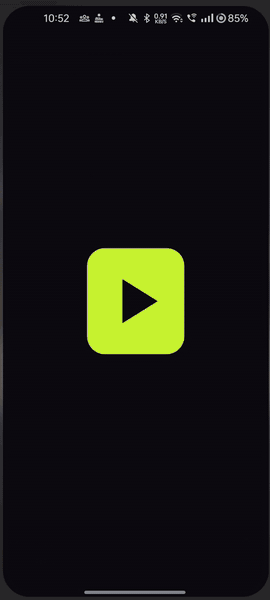
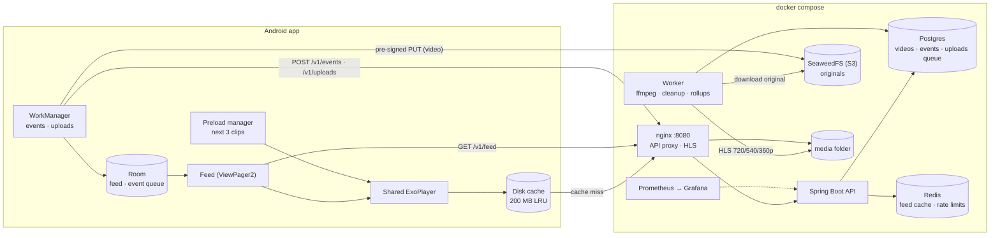
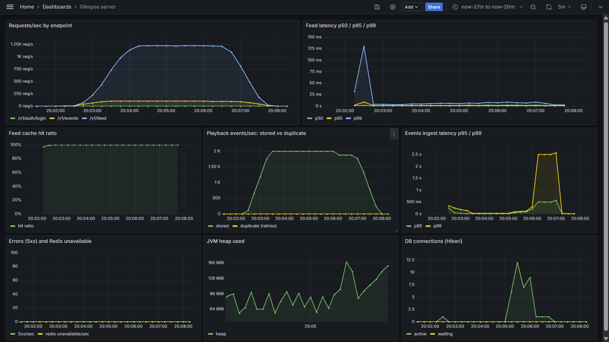

# Glimpse

[](https://github.com/arnavjot/glimpse/actions/workflows/ci.yml)


A short-video app, Java end to end: an Android client (Java, XML) with a vertical swipe feed,
and a Spring Boot backend. The point of the project is **measured playback performance**:
clips are preloaded around the one on screen, served from a disk cache, and every start time
is recorded, so the app can show how much faster clips start with preloading on than off.

<p align="center">
  
  <br><sub>Release build on a Realme phone over Wi-Fi: cold launch, then swiping. The overlay prints each clip's time to first frame.</sub>
</p>

Around that: creators post clips (pre-signed uploads to S3 storage, transcoded by an ffmpeg
worker into adaptive HLS), a **"For You"** feed ranked from hourly rollups of playback events
and tested against newest-first in an **A/B experiment** with significance tests, accounts
with rotating refresh tokens, **rate limits** in Redis, and feature flags with kill switches.

## What's in it

**Android app** (`android/`, Java + XML)
- Vertical feed (ViewPager2) with **one shared ExoPlayer** that moves between pages, plus
  Media3's **`DefaultPreloadManager`**: the next clip loads its first 3 seconds, the one
  after has its tracks selected, the neighbours have their playlists fetched, and anything
  further is released
- **200 MB disk cache** (`SimpleCache`, LRU) under every media read, so replays, swiping
  back and preloaded clips come from disk
- **Offline-first feed**: the UI only reads Room; the network refreshes Room, so the last
  feed opens instantly and survives losing signal. Cursor pagination loads the next page
  three clips before the end
- **Playback analytics** (time to first frame, rebuffers, watch time, completions, errors)
  written to Room first, then uploaded in batches of 100 by **WorkManager** with exponential
  backoff. Event ids are generated on the device, so a retried batch is never double counted
- **Offline-first likes**: the heart flips at once; the wish is queued in Room in the same
  transaction and sent by **WorkManager** when there is a network, even after the app is
  closed. Taps while offline collapse into one request; a versioned compare-and-delete
  means a tap made while a request is in flight is never lost; only a permanent 4xx rolls
  the like back. A separate liked-set table keeps likes across feed refreshes
- **Player controls**: tap to pause (respected when the app comes back), feed-wide mute
  that is remembered, and a progress bar. Captions and the action rail are one fixed
  overlay that cross-fades between clips instead of sliding with them
- **Share and deep links**: the share sheet sends a web link (`/v/{id}`) whose page has a
  link preview and an "Open in Glimpse" button; `glimpse://video/{id}` opens the app on
  that clip, fetching it first if it isn't in the feed
- **Sponsored clips**: the server inserts one per feed page (after the 5th clip), capped
  per device per day and rotated by what that device has seen least; impressions and
  "Learn more" taps go through the analytics pipeline. Labelled, no like or share, and
  never shown offline (cached ones are dropped whenever the feed can't be refreshed)
- **Creator accounts**: sign up / sign in, a session kept encrypted with an Android
  Keystore key (AES-GCM), and an OkHttp interceptor + authenticator that refresh the
  access token early, or on a 401, single-flight (one refresh for many requests) and retry
  once; a refused refresh signs out, an offline one keeps the session
- **Creator uploads**: the system photo picker (no storage permission), a copy into app
  storage, then a foreground WorkManager job that PUTs the file straight to object storage
  with a pre-signed URL (streamed, with progress) and survives restarts. A retry reuses the
  same upload (no duplicate clip) but sends the whole file again from the start; resuming
  mid-file needs multipart uploads (see Next steps). One refused by a rate limit (429) waits
  and retries. My uploads shows
  sending %, processing and live, opens live clips, deletes clips and cancels uploads still sending
- **Push notifications** (Firebase Cloud Messaging, opt-in in Settings): data-only
  "new clip" pushes to a topic; the app builds the notification with the clip's poster,
  and tapping it opens that clip at the top. Asks for permission only when switched on
- **Performance screen**: p50 / p95 time to first frame with preloading on vs off, rebuffers
  per play and the cache's byte hit ratio, measured on your phone over the last 7 days
  (older samples are pruned, and the table is capped)
- **Design system** (dark-first Material 3 tokens: colour, type, spacing, shape) mapped
  into `colors.xml` / `values-night`, `type.xml`, `dimens.xml` and `themes.xml`; edge to
  edge on every screen; 48dp touch targets and TalkBack labels
- **Settings**: server address (emulator or phone on Wi-Fi), a preloading on/off switch for
  A/B measurement, and a time-to-first-frame overlay
- MVVM (ViewModel + LiveData), **Dagger 2**, Retrofit + OkHttp, Room, Glide
- **R8** release build, a **Macrobenchmark** module (cold startup, swipe frame timing) and
  a **Baseline Profile** generator

**Backend** (`backend/`, Java 17, Spring Boot 3)
- `GET /v1/feed`: keyset (cursor) pagination over `(published_at, id)` in SQL, cached in Redis
  with jittered TTLs; Redis calls time out after 500 ms and the feed falls back to Postgres
- `POST /v1/events`: batched, **idempotent** ingestion (JDBC batch of
  `INSERT … ON CONFLICT DO NOTHING` on the device-generated event id), up to 500 per batch
- `PUT/DELETE /v1/videos/{id}/like`: idempotent per device, counter updated in the same transaction
- **Uploads and video processing**: `POST /v1/uploads` returns a pre-signed URL; the phone
  PUTs straight to S3-compatible storage (SeaweedFS), so video never passes through the
  API; `/complete` checks the object and queues it. A worker turns it into adaptive HLS
  (720p / 540p / 360p, aligned keyframes, master playlist) plus a poster and publishes it
  to the feed. The uploads table is the queue: `FOR UPDATE SKIP LOCKED` claims, a lease that
  hands a crashed worker's job to another, up to 3 attempts, guarded state changes
  (`pending_upload → uploaded → processing → ready | failed`), atomic publish. Scale with
  `docker compose up -d --scale worker=3`. Behind the `uploads` kill switch. `DELETE /v1/uploads/{id}` takes a clip out of the feed at
  once; a cleanup job in the worker (every 5 minutes, claims with `DELETE ... RETURNING`)
  then removes its files, plus uploads abandoned for 24 hours and failures older than 7 days
- **The worker** is the same image with `WORKER_ENABLED=true` and never serves the API. Its
  3 scheduler threads each do one job, so a long transcode never delays the others: the
  upload loop (every 2 s), cleanup (every 5 min), and rollups + ranking (every 5 min, see
  ["For You" and the A/B test](#for-you-and-the-ab-test))
- **Rate limits** (Redis token buckets): sign-in, sign-up and refresh per IP, uploads per
  account (10 an hour, 3 in progress), `429` with `Retry-After`. See [Rate limits](#rate-limits)
- Accounts: `POST /v1/auth/register|login|refresh|logout`, `GET /v1/me`. BCrypt
  passwords, HS256 JWT access tokens (15 min), opaque refresh tokens (30 days) stored only
  as SHA-256 and rotated on every use; reusing an old one revokes every session (token
  theft). Equal-time answers for unknown emails, 10 attempts per email per 15 minutes
- `GET /v1/config`: feature flags and remote values for the device (rollout buckets, ETag),
  plus admin update and kill-switch endpoints
- Sponsored clips per request (`X-Device-Id` header): placement, a daily cap counted from
  `ad_impression` events, least-seen rotation; the organic page stays cached and shared
- `POST /v1/admin/push/new-clip/{id}` (header `X-Admin-Token`): pushes a new clip to the
  `new-clips` topic through the Firebase Admin SDK; off unless configured
- `GET /v1/feed?first={id}`: a shared clip first on the opening page (moved, not duplicated)
- `GET /v1/videos/{id}`: one clip, for opening a shared link; `GET /v/{id}`: the share page
  (Open Graph tags for link previews, every value HTML-escaped, deep link into the app)
- `GET /v1/stats/playback`: time to first frame split by preload on/off (Postgres
  `percentile_disc`, nearest-rank), rebuffers per play; `GET /v1/videos/{id}/stats`;
  `GET /v1/videos/{id}/stats/hourly` from the rollups
- Spring Web, Spring JDBC (`JdbcTemplate`), **Flyway** migrations, Spring Data Redis (Lettuce),
  Bean Validation, **Micrometer + Actuator** (Prometheus metrics, health probes)
- Videos are **HLS with 2-second segments** (a keyframe every 2 s, so playback can start after
  one segment), generated locally with ffmpeg from its built-in test sources: no third-party
  footage. nginx serves them with year-long immutable caching for segments
- **Grafana dashboard** (provisioned): requests/sec, feed latency p50/p95/p99, feed cache hit
  ratio, events stored vs duplicates, ingest latency, 5xx and Redis-unavailable, JVM heap,
  DB connection pool
- **JUnit 5 + Testcontainers**: tests run against real Postgres, Redis and SeaweedFS (S3) in
  Docker, and the transcoding tests run real ffmpeg, in CI too
- Docker Compose (API, upload worker, Postgres, Redis, SeaweedFS, nginx, Prometheus, Grafana),
  k6 load test,
  [failure drills](backend/drills/README.md)



## Numbers

Measured on a physical phone (emulator timings aren't meaningful): Realme RMX3395, Android 14,
release build (R8), on home Wi-Fi with the backend on a laptop on the same network. Playback:
two passes over the 13-clip library, ~4 s per clip, each pass on a fresh install (empty cache),
one with preloading off and one with it on. Small sample, and a LAN is kinder than the internet;
the gap would be larger on a slower network. The sections below say how to get each number.

| Metric | Result | How |
|---|---|---|
| Time to first frame, preloading **off** (median / slowest, clips 2–14) | 290 ms / 590 ms | Performance screen + `playback_events` |
| Time to first frame, preloading **on** (median / slowest, clips 2–14) | **196 ms / 246 ms** (−32% / −58%) | Performance screen + `playback_events` |
| Time to first frame, first clip of a session (off / on) | 440 ms / 846 ms: nothing to preload yet, so this is app start + feed load | `playback_events` |
| Rebuffers per play | 0 in 28 plays | Performance screen |
| Disk cache byte hit ratio | 79% (clips loop, so replays come from disk) | Performance screen |
| Cold start without / with Baseline Profile (median of 10, time to initial display) | 821 ms / **684 ms (−17%)**; slowest 1,242 → 836 ms (−33%) | `StartupBenchmark` |
| Swipe frame CPU time p50 / p90 / p95 / p99 (5 runs × ~3,800 frames, 60 Hz) | 7.0 / 8.5 / 10.0 / 23.7 ms; frame overrun p95 −5.6 ms (on time), p99 +8.8 ms (late) | `FeedScrollBenchmark` |
| Release APK size (R8) vs debug | 3.1 MB vs 10.6 MB | `./gradlew assembleRelease` |
| Backend feed p95 / p99, failures (laptop: i7-1165G7, whole stack in Docker Desktop) | 300 sessions/s: 3.9 / 12.9 ms, 0 of 91,188 failed. 1,000 sessions/s (1,120 req/s): 2.6 / 11.6 ms; 5 of 302,427 failed, all event uploads during one 3 s database stall (Postgres checkpoint on Docker's virtual disk; the app's queue retries them) | k6 `load/feed.js` |
| Creator upload: 15 s 1080p clip (13.3 MB) posted from the phone over Wi-Fi | Post → in the feed **40.5 s**: upload link 0.27 s; transfer ~31 s (~3.4 Mbit/s into SeaweedFS behind Docker Desktop's port forwarding); worker picked it up at once; ffmpeg to 720p/540p/360p HLS + poster **9.4 s** (0.6× the clip's length) | `uploads` row + worker log |
| Redis down (drill 3) | feed `200` every time: first request 517 ms, then ~10 ms (circuit breaker skips Redis) | [drills](backend/drills/README.md) |
| Phone offline for 24 clips (drill 1) | 78 events queued → 78 stored, 0 lost, 0 duplicates | [drills](backend/drills/README.md) |
| App killed mid-upload (drill 2) | 75 events stored once; 150 retried copies recognised as duplicates | [drills](backend/drills/README.md) |
| Postgres down (drill 4) | cached clips kept playing, 34 events queued → 34 stored. Gaps found: feed `500` once its cache expired; upload back-off delayed delivery >4 min after recovery | [drills](backend/drills/README.md) |
| Tests | Android: unit tests with JUnit, Robolectric and MockWebServer. Backend: integration tests with JUnit 5 and Testcontainers (real Postgres, Redis and SeaweedFS; real ffmpeg) | CI |

The 1,000 sessions/s run in the provisioned Grafana dashboard: ~1.2K feed req/s held for three
minutes with feed p99 in single-digit milliseconds (the spike at the start is JVM warm-up), ~2K
playback events/s stored with no duplicates. The bump in events ingest latency and DB connections
around 20:06 is the 3 s Postgres checkpoint stall; the feed, served from Redis, didn't notice it.



## Run it

### 1. Backend

Needs Docker. From `backend/`:

```bash
docker compose up -d --build
```

The first start generates 24 twelve-second clips with ffmpeg (about a minute), builds the
Spring Boot server, applies the Flyway migration, seeds the videos and starts nginx on `:8080`
(the API and the videos; phones use this), the API itself on `localhost:8000` (tools on this
computer only), the upload worker, SeaweedFS (S3 storage for uploads) on `:8333`,
Prometheus on `:9090` and Grafana on `:3000` (dashboard
"Glimpse server"). Check it:

```bash
curl localhost:8000/actuator/health/readiness
curl "localhost:8000/v1/feed?limit=2"
```

**Using a real phone?** The feed hands out video URLs, so tell the backend your computer's
Wi-Fi address before starting it (phone and computer on the same Wi-Fi):

```bash
MEDIA_BASE_URL=http://192.168.1.20:8080/media docker compose up -d --build
```

### 2. Android app

Open `android/` in Android Studio and run the `app` configuration, or:

```bash
cd android && ./gradlew :app:installDebug
```

On the emulator it finds the backend at `http://10.0.2.2:8080/` by default. On a phone, open
**Settings** (gear icon) and set the API address to `http://YOUR-COMPUTER-IP:8080/`.

## Use real videos

Out of the box the feed plays synthetic clips generated with ffmpeg. To use real footage:

1. Download portrait (9:16) clips from [Pexels](https://www.pexels.com/videos/) or
   [Pixabay](https://pixabay.com/videos/) (free licenses; filter Orientation: Portrait),
   or use your own, into `backend/media-src/`. They play in file-name order.
2. Optional: copy `media-src/credits.example.csv` to `credits.csv` and give each clip a
   title and its creator's name.
3. Rebuild the library and reseed the database (run in `backend/`):

   ```sh
   docker compose up -d postgres
   docker compose exec postgres psql -U glimpse -c "TRUNCATE likes, playback_events, videos"
   rm media/manifest.json
   docker compose up -d --force-recreate media api
   docker compose exec redis redis-cli FLUSHALL   # drop feed pages cached before the reseed
   ```

   `scripts/ingest_videos.sh` crops each file to 720x1280, cuts it to 15 seconds, keeps the
   sound, and writes HLS with 2-second segments plus a poster. New clips get new ids
   (`s001`...), so phones and nginx don't serve cached segments of the old ones.
4. In the app, pull down to refresh.

The video files in `media-src/` are git-ignored: the licenses allow use in an app, not
redistribution in a repository.

## Share links and deferred deep links

A shared clip is a web link, `https://<share host>/v/<id>`, and it behaves the way share
links do in apps like Instagram or YouTube:

| Who taps it | What happens |
|---|---|
| Has the app, link is an App Link | Android opens the app on the clip; no browser |
| Has the app, any browser | The page's "Open in Glimpse" (an Android intent URL) opens the app on the clip |
| Doesn't have the app | Same button: Chrome falls back to the Play Store. The Play link carries `video_id` in the install referrer, and the **first launch after installing opens that clip** (Play Install Referrer API) |
| Desktop or iPhone | The page shows the clip and a Google Play link |

To turn on App Links for your domain:

1. Serve the backend over HTTPS on that domain and set `glimpseShareHost=your.domain`
   in `android/gradle.properties` (share links then use it).
2. Set `APP_CERT_SHA256` for the API to the app's signing-certificate SHA-256
   fingerprints (Play Console, App integrity; comma separated). The backend then serves
   `/.well-known/assetlinks.json`, which Android checks at install.

The deferred part can only be tested with an install from Google Play (an internal
testing track is enough): sideloaded and debug installs have no Play referrer.

## Uploads on a phone

The pre-signed upload URL must use an address the phone can reach. Start the stack with it
(in `backend/`), next to the media address:

```sh
MEDIA_BASE_URL=http://<PC-IP>:8080/media S3_PUBLIC_ENDPOINT=http://<PC-IP>:8333 docker compose up -d
```

Then in the app: sign in (Settings, Account), tap **+** on the feed, pick a video, post.
Follow it in Settings, My uploads; it appears at the top of the feed once processed.

## Feature flags and remote config

Flags live in the `remote_config` table and change without a release:

| Field | Meaning |
|---|---|
| `enabled` | The kill switch: `false` turns the feature off for every device |
| `rollout_percent` | Gradual rollout: on for this share of devices. Each device's bucket is a hash of flag + device id, so it is stable and each flag uses its own slice |
| `value` | An optional setting the feature reads (e.g. `sponsored_slot = 5`) |

Seeded flags: `sponsored_clips`, `sponsored_slot`, `preload`, `share_cards`,
`push_notifications`, `config_refresh_seconds`. The app fetches `GET /v1/config` at launch
and on returning to the foreground (at most every `refresh_seconds`, revalidated with an
ETag so unchanged config is a 304), keeps the last good copy for offline use, and falls
back to built-in defaults before its first fetch. The server caches flags for 5 seconds.

```sh
# Kill switch (run in backend/, with ADMIN_TOKEN set on the API)
curl -X POST -H "X-Admin-Token: $ADMIN_TOKEN" localhost:8000/v1/admin/config/sponsored_clips/kill
# Roll preloading out to 10% of devices, or change a value
curl -X PUT -H "X-Admin-Token: $ADMIN_TOKEN" -H "Content-Type: application/json"      -d '{"enabled":true,"rollout_percent":10}' localhost:8000/v1/admin/config/preload
```

## Push notifications (Firebase)

Optional: without these files everything builds and runs, with push turned off.

1. Create a project at [console.firebase.google.com](https://console.firebase.google.com)
   and add an Android app with package `com.arnavjot.glimpse`.
2. Download `google-services.json` into `android/app/` (git-ignored) and rebuild the app.
3. Project settings, Service accounts, "Generate new private key": save it as
   `backend/secrets/firebase.json` (git-ignored).
4. Pick an admin secret and restart the API (in `backend/`):
   `ADMIN_TOKEN=some-long-secret docker compose up -d api`
5. On the phone: Settings, "New clip notifications" on (allow the permission).
6. Announce a clip:

   ```sh
   curl -X POST -H "X-Admin-Token: some-long-secret" localhost:8000/v1/admin/push/new-clip/s001
   ```

## Open it in Android Studio and IntelliJ

You need Docker Desktop running for the backend's database, cache and tests.

**Backend in IntelliJ IDEA** (Community is fine)
1. **File → Open** and pick the `backend/` folder (not the repo root). Choose "Open as Gradle project"
   if asked, and wait for the Gradle sync to finish.
2. **File → Project Structure → SDK**: pick a JDK 17 or newer (IntelliJ can download Temurin 17).
3. Start only the services the server needs, from a terminal in `backend/`:
   `docker compose up -d postgres redis media nginx prometheus grafana`
4. Open `src/main/java/com/arnavjot/glimpse/server/GlimpseServerApplication.java` and click the
   green ▶ next to `main`. It connects to Postgres and Redis on localhost, runs the Flyway migration,
   seeds the clips the `media` container generated and serves the API on `:8000`.
   (Port 8000 is taken if the Docker `api` container is running: `docker compose stop api`.)
5. Tests: right-click `src/test/java` → **Run 'Tests'**. Testcontainers starts its own Postgres and
   Redis, so Docker must be running.

Or skip the IDE run and start everything in Docker: `docker compose up -d --build`.

**App in Android Studio**
1. **File → Open** and pick the `android/` folder. Let the Gradle sync finish (first time takes a few minutes).
2. **Settings → Build, Execution, Deployment → Build Tools → Gradle → Gradle JDK**: choose
   the bundled JetBrains Runtime (17+).
3. Create an emulator (**Device Manager → +**, any Pixel, API 34) or plug in your phone with USB debugging on.
4. Select the `app` configuration and press ▶. The app expects nginx on 8080; with the backend
   running from IntelliJ instead, tap the gear icon and set the API address to
   `http://10.0.2.2:8000/` (emulator) or `http://YOUR-COMPUTER-IP:8000/` (phone), and start the
   backend with `MEDIA_BASE_URL` as shown above.
5. Unit tests: right-click `app/src/test/java` → **Run 'Tests'**.
6. For real numbers, switch **Build → Select Build Variant** to `release` (R8 on) before measuring.

## Measuring

**Time to first frame, preload on vs off.** Install the release build on a phone
(`./gradlew :app:installRelease`). In Settings turn preloading **off**, swipe through ~30 clips
at a normal pace, turn it **on**, swipe ~30 more, then open the Performance screen (speed icon).
Clear the app's storage first so the disk cache starts empty. The same numbers reach the
backend: `curl localhost:8000/v1/stats/playback`.

**Cold start and the Baseline Profile.** With the phone connected and USB debugging on:

```bash
cd android
./gradlew :app:generateBaselineProfile                       # writes the profile into the app
./gradlew :benchmark:connectedBenchmarkReleaseAndroidTest     # runs the startup and swipe benchmarks
```

Results are printed and saved under `benchmark/build/outputs/`. Compare
`coldStartWithoutBaselineProfile` with `coldStartWithBaselineProfile`. Build with
`-PglimpseApiUrl=http://YOUR-COMPUTER-IP:8080/` so the reinstalled app finds the server.

On Realme / Oppo / ColorOS phones the benchmarks fail with "Failed to grant permissions" unless
**Developer options → Disable permission monitoring** is on. Expect it to be slow there: profile
generation took ~25 minutes and each swipe iteration ~4 minutes (a 400 MB trace each).

A quicker check without Macrobenchmark (`am start -W` for start time, `dumpsys gfxinfo` for
frames) is fine for a rough start time and frame timing but not for judging the profile: with
`cmd package compile -m verify` vs `-m speed` it showed 355 vs 346 ms, a 3% gap, where
Macrobenchmark (which resets compilation its own way and traces every launch, so its absolute
numbers are higher) measured 17%. Use the benchmark for that comparison.

**Backend under load.** With the stack running:

```bash
docker run --rm -i --network glimpse_default -v "$PWD/load:/load" \
  -e BASE_URL=http://api:8000 -e TARGET_RPS=300 grafana/k6 run /load/feed.js
```

## Tests

```bash
cd backend && ./gradlew test          # needs Docker running (Testcontainers)
cd android && ./gradlew :app:testDebugUnitTest :app:lintDebug
```

Tests worth reading: each checks a failure that really happens in production.

| What can go wrong | Test |
|---|---|
| The phone retries a batch of events after a timeout | `aRetriedBatchIsStoredOnce`: the same batch sent twice is stored once |
| Redis goes down | `RedisDownTest.theFeedStillWorksFromPostgres`: the feed keeps working, just uncached |
| A refresh response is lost on a bad connection | `aRetryAfterALostResponseIsNotTreatedAsTheft`, and `replayingATokenWhoseReplacementWasUsedIsStillTheft` so theft is still caught |
| Two phones refresh the session at once | `concurrentRefreshesMakeOneCall` (Android): one refresh, not two that invalidate each other |
| A worker crashes mid-transcode | `aJobLeftByACrashedWorkerIsTakenOver` |
| A worker's lease runs out while it is still working | `aWorkerWhoseJobWasTakenOverDropsItsOutput`: no files left behind |
| A creator deletes a clip while it is being processed | `aClipDeletedWhileProcessingIsNeverPublished` |
| ffmpeg hangs | `aCommandThatHangsIsKilledAtTheTimeLimit` |
| Someone uploads more than they declared | `storageRefusesAFileThatIsNotTheDeclaredSize`: storage refuses it (signed size) |
| Scores change while someone scrolls "For You" | `scrollingKeepsItsOrderWhenScoresChange`: no repeats, nothing skipped |
| One machine tries many accounts | `oneMachineCannotTryManyAccounts`, and `aForgedForwardedForHeaderDoesNotGetAFreshAllowance` |
| Everyone arrives through nginx | `RateLimitBehindProxyTest`: each client behind the proxy has its own allowance |
| An app crashes mid-upload | `anAbandonedUploadDoesNotHoldASlot`: an expired upload doesn't count against the cap |
| A rollup runs twice, or events arrive late | `eachEventIsCountedExactlyOnce`, `theLastMinuteWaitsForTheNextRun` |
| The experiment split changes mid-test | `aDeviceKeepsItsVariantWhenTheSplitChanges` |
| An event batch is rejected while offline for days | `aRejectedBatchIsDroppedSoItCantBlockTheQueue`, `theQueueIsCappedWhenOfflineForLong` (Android) |

The backend tests run against real Postgres, Redis and S3 storage (Testcontainers) and real
ffmpeg, not mocks; the Android tests use MockWebServer, an in-memory Room and Robolectric.

CI (GitHub Actions) runs both on every push, plus the release build and the benchmark module.

## "For You" and the A/B test

- **Rollups**: every 5 minutes the worker folds new playback events into hourly totals per clip.
  The bookmark moves in the same transaction as the totals, so each event counts exactly once.
  `GET /v1/videos/{id}/stats/hourly` reads them.
- **Ranking**: completion rate and like rate, smoothed towards the site average (one play and one
  finish isn't "100%"), plus a freshness boost. The order is frozen into numbered snapshots and
  the feed cursor names its snapshot, so scrolling never repeats or skips a clip.
- **Experiment** `feed_ranking`: control is newest first, treatment is "For You". Each device's
  variant is stored the first time it is seen (sticky), the server decides, and the app needs no
  change. Switching it off serves newest to everyone at once; a scroll in progress still finishes.
- **Results**: `GET /v1/admin/experiments/feed_ranking/report` compares watch time per device
  (Welch's t-test) and completion rate (two-proportion z-test), counting only events after each
  device's first exposure, and refuses to name a winner below 30 devices per variant.

```bash
curl -H "X-Admin-Token: $ADMIN_TOKEN" localhost:8000/v1/admin/experiments/feed_ranking/report
curl -X PUT -H "X-Admin-Token: $ADMIN_TOKEN" -H "Content-Type: application/json"      -d '{"enabled":false}' localhost:8000/v1/admin/experiments/feed_ranking     # kill switch
```

## Rate limits

| What | Limit | Why |
|---|---|---|
| Sign-in per IP | 20, refilling over 10 min | The per-email limit (10 per 15 min) stops guessing one account's password; this stops one machine trying a few passwords on each of 1,000 accounts. Checked before BCrypt, so a flood can't tie up the CPU |
| Sign-up per IP | 5 an hour | Sign-ups are slow on purpose (BCrypt) and create accounts |
| Session refresh per IP | 60, refilling over 10 min | Cheap, but shouldn't be floodable |
| Uploads per account | 10 an hour, at most 3 in progress | The most expensive feature: storage, then three ffmpeg encodes per clip. An upload whose URL expired doesn't hold a slot |

- **Token buckets in Redis**: one Lua script reads, refills and takes atomically, using Redis's
  clock, so every API instance shares the same count and two requests can't both take the last
  token. Over the limit: `429` with `Retry-After` and a message such as *"too many sign-in
  attempts from your network, try again in 2 minutes"*, which the app shows as is. A refused
  upload is retried later by WorkManager.
- **Redis down**: limits fail open (counted in `glimpse_ratelimit_unavailable_total`), so an
  outage of the limiter never becomes an outage of sign-in.
- **The real client IP**: nginx is the only way in (port 8080; 8000 listens on localhost only).
  It overwrites `X-Forwarded-For` with the address it sees, and Spring trusts that header only
  from nginx's fixed address (`TRUSTED_PROXY`). Without this, everyone would arrive "from
  nginx" and one busy client would lock out everybody; with a naive trust, a client could send
  a new fake IP with every request.
- Limits are generous per IP because people behind one router or mobile carrier share an
  address. Note: Docker Desktop on Windows and macOS shows every caller as its gateway address
  (here `172.19.0.1`), so locally everyone shares one allowance; on a Linux host nginx sees
  real addresses.

## Design decisions

- **One player, many pages.** Decoders are scarce; one ExoPlayer moves between pages with
  `PlayerView.switchTargetView` instead of one player per page.
- **Preload by distance, not everything.** Loading clips far ahead wastes data and battery
  for clips that may never be seen; the policy (`PreloadPolicy`) spends most on the next clip.
- **HLS with 2-second segments** so the first segment is small and playback can start after
  one download.
- **Device-generated event ids** make uploads safe to retry: the server stores each id once.
- **Write events locally first** so nothing is lost offline or if the app is killed; the
  queue is capped at 5,000 events.
- **Offline-first feed**: Room is the source of truth for the UI.
- **The phone is the queue.** Events aren't on any hot path and the app already batches them, so
  the server does one idempotent batch insert per request instead of running a server-side
  queue and workers. Kafka or Redis Streams would come in once ingest volume or the number of
  consumers outgrows that.
- **JdbcTemplate over JPA**: the hot queries are keyset pagination, `ON CONFLICT` inserts and
  percentiles; plain SQL keeps each one visible and tunable.

## Project layout

```
android/app/src/main/java/com/arnavjot/glimpse/
  analytics/     playback events: Room queue, batch upload
  auth/          session (Keystore-encrypted), token refresh interceptor and authenticator
  common/        links, small helpers          config/       remote config and flags
  data/ pojo/    Room database and API models   di/           Dagger components and modules
  network/       Retrofit, OkHttp              player/       shared ExoPlayer, preloading
  push/          Firebase messaging            repository/   feed and like sync (Room first)
  ui/            activities and adapters        upload/       foreground upload worker
  viewmodel/     ViewModels
android/benchmark/   Macrobenchmark tests and the Baseline Profile generator

backend/src/main/java/com/arnavjot/glimpse/server/
  feed/          feed, cursors, cache, share pages    events/       idempotent event ingestion
  likes/         likes                                stats/        playback stats
  auth/          accounts, JWT, refresh tokens        uploads/      uploads, worker, ffmpeg, cleanup
  rollups/       hourly rollups, hourly stats         ranking/      "For You" snapshots
  experiments/   A/B assignment and report           config/       remote config and flags
  sponsored/     sponsored clips                      push/         Firebase push
  share/         app links, deep-link test page       common/       errors, rate limiter, admin auth
backend/src/main/resources/db/migration/   Flyway migrations (V1 to V7)
backend/src/test/    JUnit 5 + Testcontainers tests
backend/scripts/
  build_media.sh          builds the clip library at first start (the "media" service)
  make_media.sh           synthetic demo clips with ffmpeg
  ingest_videos.sh        real videos in media-src/ into the clip library
  fetch_commons_videos.py downloads freely licensed clips from Wikimedia Commons
  make_ads.sh             sponsored demo creatives
backend/docker/      nginx config, SeaweedFS S3 credentials
backend/monitoring/  Prometheus config and the provisioned Grafana dashboard
backend/drills/      failure drills, count.sh (counts stored events)
backend/load/        k6 load test (feed.js)
```

## Next steps

- Measuring startup and quality switching on a throttled network (uploads are already adaptive: 720p / 540p / 360p)
- Per-video preload budgets from watch-time data (preload more for clips people finish)
- Personal ranking (per-device history), not only one global "For You" order
- A per-IP limit on the public endpoints (feed, events) at nginx, before requests reach Java
- S3 multipart uploads, so a big video resumes from the last part instead of starting over
- Signed media URLs and a CDN in front of the HLS files
- More workers for bursts of uploads: scale on the queue length (uploads waiting), not CPU
